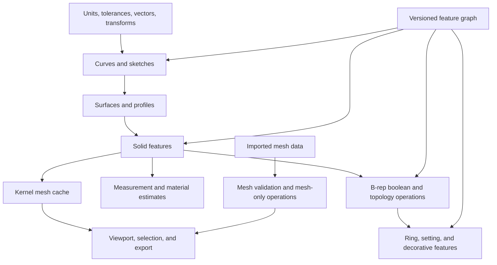

# Open Jewel CAD tool inventory

**Status:** implementation plan for the full requested product scope, including a precision-modeling workflow and a future ZBrush-inspired mesh-sculpting workflow. This is a backlog, not a claim that every command exists. The current editor starts a curve → surface → solid workflow with an editable closed polyline, planar face, and closed-profile extrusion with editable 3D direction. Its curve tools also include open line, polyline, and circular arc surface extrusions, an open-profile revolve surface, and analytic circle and ellipse profiles. It also has eight solid primitives, a parametric ring band, a faceted round-brilliant gemstone, transforms, measurements, STL/OBJ export, and one editable primitive boolean tool per project.

## 1. Product modules and ownership

| Module | Responsibility | Primary implementation |
|---|---|---|
| Desktop and viewport | Tool palettes, panels, input, selection presentation, camera, materials, and display modes | Rust / eframe-egui; OpenGL-backed display is the current direction |
| Application core | Typed commands, document transactions, task scheduling, cancellation, undo/redo | Rust |
| Document and history | Versioned features, stable IDs, parameters, dependency graph, migrations, recovery | Rust |
| Geometry API | Narrow, versioned calls; validation and error conversion; safe shape ownership | Rust wrapper + C ABI |
| B-rep kernel | Curves, surfaces, solids, booleans, transformations, topology, measurements, healing | C++ / OCCT |
| Jewellery | Ring, gemstone, setting, decorative, and domain-specific manufacturing rules | C++ algorithms coordinated by Rust commands |
| Mesh and exchange | Tessellation, mesh utilities, file adapters, import checks, export | C++/OCCT plus separately evaluated format libraries where needed |
| Scripting | Validated script-to-command interface and automation | Rust command API first; Python binding only after command safety and lifecycle are established |

The desktop must not own OCCT objects or implement CAD algorithms. Kernel objects remain behind opaque handles. Geometry is stored in millimetres; every tolerance, import unit, failure, and validation result is explicit. UI commands call typed application operations and report real results; a button without a working command is not a completed tool.

## 2. Command contract and naming

Every released command has a stable name (`curve.line.create`, `solid.cylinder.create`, `boolean.cut`, `jewelry.ring.build`, etc.), typed parameters with units and bounds, selected inputs, an explicit tolerance policy where relevant, a deterministic output or structured failure, and a test fixture. Modifying commands run in document transactions and create undoable history entries. Long-running commands support progress and cancellation. Commands record algorithm/version metadata so saved projects can be regenerated or diagnosed after an upgrade.

Suggested command namespaces:

`sketch.*`, `curve.*`, `surface.*`, `solid.*`, `boolean.*`, `transform.*`, `jewelry.ring.*`, `gemstone.*`, `setting.*`, `decoration.*`, `edge.*`, `text.*`, `mesh.*`, `measure.*`, `manufacturing.*`, `document.*`, and `view.*`.

## 3. Complete tool and command catalog

### Curves and sketches — `sketch.*`, `curve.*`

- Creation: Line, Polyline, Freeform Curve, Interpolated Curve, Control Point Curve, Sketch, Arc, Circle, Ellipse, Rectangle, Polygon, Spiral, Helix, Conic.
- Offsets and blends: Offset, Offset Both Sides, Fillet Curve, Chamfer Curve, Blend Curve.
- Editing: Extend, Trim, Split, Join, Explode, Rebuild, Simplify, Smooth, Fair, Close Curve, Reverse Curve, Match Curve, Tween Curves, Curve Editing, Control Point Manipulation.
- Model relationships: Project, Pull, Intersect, Duplicate Edge, Duplicate Border, Curve Boolean.
- **Implemented:** an open XY line with editable endpoints and an open XY polyline with 2–64 ordered editable vertices; both use exact OCCT wire geometry, measured lengths, input validation, and project persistence. Also implemented: a closed straight-sided XY polyline with 3–64 editable vertices; dimensioned rectangle and regular-polygon constructors in the UI and CLI; analytic circle and ellipse tools with curve → planar face → extruded solid workflows; and an open circular arc with editable radius, start angle, and sweep. Line, open-polyline, and closed-polyline curves can reverse direction; a validated open polyline can be closed into a reusable profile. Both edits are available through the editor and CLI, preserve project data, and validate regenerated OCCT geometry. Constructor results remain point-editable and feed the existing planar-surface, extrusion, and revolve stages. Other open curves, splines, constraints, snapping, curve booleans, and multi-curve selection remain planned.

### Surfaces — `surface.*`

- Construction: Planar Surface, Edge Surface, Loft, Sweep 1 Rail, Sweep 2 Rails, Revolve, Rail Revolve, Network Surface, Patch, Extrude Curve, Extrude Along Curve.
- Editing: Offset Surface, Variable Offset, Extend Surface, Trim Surface, Split Surface, Join Surfaces, Match Surface, Blend Surface, Fillet Surface, Rebuild Surface, Refit Surface, Shrink Trimmed Surface, Untrim Surface, Merge Surface, Extract Isocurve, Extract Surface Edges, Cage Editing.
- **Implemented:** planar faces built from a saved closed polyline, analytic circle, or analytic ellipse, with OCCT validity, area, centroid/bounds, and exact tessellation. Open line and polyline curves and circular arcs can be extruded along any non-zero 3D direction into valid OCCT surface shells. An open polyline profile can also be revolved 360° around Y to create a surface shell. Their area and tessellation are measured, and their source parameters and profile points are saved. Curved trims, NURBS surfaces, multi-edge construction, and surface editing remain planned.

### Solids — `solid.*`

- Primitives and generators: Box, Sphere, Cylinder, Cone, Truncated Cone, Ellipsoid, Torus, Pipe, Extruded Solid, Revolved Solid, Swept Solid, Lofted Solid.
- Editing and topology: Shell, Thicken, Offset Solid, Cap Planar Holes, Create Solid, Extract Solid Faces, Split Solid, Join Solid, Merge Faces.
- **Implemented:** Box, Cylinder, Cone, Truncated cone, Ellipsoid, straight Pipe, Sphere, Torus, and a ring band with editable inner diameter, wall thickness, and width. These create and validate OCCT B-rep solids. The pipe is a straight tube along Z; a pipe swept along a user-drawn curve remains planned.
- **Implemented:** Extruded solids from a saved closed 2D polyline, analytic circle, or analytic ellipse, with live preview, validation, versioned save/load, exact OCCT extrusion along an editable 3D direction, measurement, and export. The preview follows the same direction and remains fitted in the viewport. Curved polyline segments, sketch constraints, and profile-as-boolean-tool remain planned.
- **Implemented:** a full 360° revolved solid from an editable closed XY profile whose X coordinates stay at positive radius from the Y axis. The UI and CLI can generate a ring cross section, the result is exact OCCT geometry, and the profile persists from project version 12 onward. Partial revolves, alternate axes, and revolved surfaces remain planned.

### Boolean and intersection — `boolean.*`

- Boolean Union, Boolean Difference, Boolean Intersection, Boolean Split, Boolean 2D, Curve Boolean, Surface Boolean, Solid Boolean, Mesh Boolean Union, Mesh Boolean Difference, Mesh Boolean Intersection, Mesh Split, Wire Cutting, Automatic Intersection Detection.
- **Implemented:** exact OCCT union, difference, and intersection between a saved base primitive and one parametric tool primitive. The `.ojcad` v3 project retains both inputs, operation, and tool placement; the editor shows the resulting OCCT mesh after regeneration. Multi-feature chains and the rest of the listed operations remain planned.
- Multi-object, nested, coincident, near-tangent, and tolerance-sensitive cases need explicit behaviors and regression fixtures. B-rep booleans and triangle-mesh booleans are distinct command families; one must not silently convert the other.

### Transformations — `transform.*`

- Move, Copy, Rotate, Rotate 3D, Scale, Scale 1D, Scale 2D, Mirror, Mirror 3D, Linear Array, Polar Array, Array Along Curve, Array Along Surface, Orient, Orient 3 Points, Align, Flow Along Curve, Flow Along Surface, Bend, Twist, Taper, Shear, Cage Edit, Gumball Manipulator.

**Implemented:** Linear arrays with XYZ spacing and polar arrays around the world Z axis are editable saved project features. Each array is a native OCCT compound of copied B-rep geometry, limited to 64 copies for predictable preview and regeneration cost. The viewport previews the copies and fits the patterned model; wheel zoom, middle-button pan, orbit, and Fit support model framing. World-plane mirrors across YZ, XZ, or XY are saved on the model and Boolean tool and regenerate as exact OCCT geometry. Measurement and STL/OBJ export use the regenerated compound. Arrays along curves/surfaces, arbitrary polar axes, and gumball interaction remain planned.

### Ring and jewellery construction — `jewelry.ring.*`, `decoration.*`

- Ring Builder, Ring Shank Builder, Ring Rail, Ring Profile, Ring Resizer, Ring Sizer, Ring Head, Ring Shoulder, Ring Gallery, Ring Basket, Ring Band, Split Shank, Multi-Shank, Tapered Shank, Comfort Fit.
- Milgrain Generator, Filigree Generator, Engraving, Emboss, Deboss, Relief Generator, Floral Patterns, Decorative Patterns, Chain Generator, Link Generator, Bead Generator, Gallery Generator, Under Gallery Generator, Ornament Generator, Repeating Motif Generator.

Each generator needs named parameters, units, domain validation, stable feature history, and jewellery-specific geometry tests. A ring size conversion or “comfort fit” profile must be documented rather than inferred from a display label.

### Gemstones and settings — `gemstone.*`, `setting.*`

- Gemstones: Gemstone Library; Round Brilliant, Oval, Princess, Emerald, Pear, Marquise, Cushion, Radiant, Heart, Baguette, Trillion, and Custom Gemstone; Stone Orientation, Stone Placement, Stone Array, Stone Distributor, Stone Measurement, Stone Clearance, Stone Cutter, Gemstone Seat Generator.
- Settings: Prong Setting, Shared Prong, Bezel Setting, Channel Setting, Pavé Setting, Micro Pavé, Halo Setting, Flush Setting, Gypsy Setting, Bar Setting, Cluster Setting, Illusion Setting, Basket Setting, Tension Setting, Invisible Setting, Automatic Stone Seating, Automatic Prong Generation, Prong Cutter, Prong Resizing, Prong Position Adjustment.

The stone profile library, facet layout, orientation, clearance rules, seat cutting, and setting generators are application-specific algorithms. OCCT can construct and combine their resulting geometry; it does not supply jewellery design rules or a validated gemstone catalogue.

**Implemented:** A parametric round-brilliant gemstone is generated as a closed, 32-segment faceted solid with an editable girdle diameter, total height, and table diameter. It supports transforms, booleans, measurement, project save/reopen, and STL/OBJ export. This is a geometric starter tool; calibrated gemstone proportions, cut grades, stone placement, seats, and setting workflows remain planned.

### Edge detailing and analysis — `edge.*`, `analysis.*`

- Fillet Edge, Variable Fillet, Chamfer Edge, Blend Edge, Offset Edge, Extract Edge, Edge Repair, Edge Matching, Edge Analysis, Surface Continuity Analysis, Zebra Analysis, Curvature Analysis, Draft Analysis, Wall Thickness Analysis.

Analysis commands must return measured values or diagnostics with units and tolerance assumptions. Zebra display and similar visual continuity checks are visualization aids, not manufacturing acceptance certificates.

### Text, engraving, and imported artwork — `text.*`, `artwork.*`

- 2D Text, 3D Text, Text Along Curve, Text on Surface, Engraving, Embossing, Debossing, Logo Import, SVG Import, Image Tracing, Pattern Projection, Custom Lettering.

Text geometry depends on a selected/licensed font, outline extraction, curve cleanup, placement, and kernel operations. Raster tracing is an approximation workflow and must show its tolerance and editable result.

### Mesh and manufacturing exchange — `mesh.*`, `exchange.*`

- NURBS to Mesh, Mesh Generation, Mesh Reduction, Mesh Smoothing, Mesh Welding, Mesh Unwelding, Mesh Hole Filling, Mesh Boolean, Mesh Repair, Mesh Split, Mesh Union, Mesh Offset, Remeshing, Decimation, Mesh Validation, STL Export, OBJ Export, 3MF Export.
- STEP Import and Export, 3DM Import and Export, Mesh Repair, Non-Manifold Detection, Naked Edge Detection, Wall Thickness Inspection, Hollow Model Detection, Volume Calculation, Print Orientation, Support Planning, Casting Shrinkage Compensation, Resin Printing Preparation, Manufacturing Validation.

OCCT provides B-rep triangulation and data-exchange components for common CAD/mesh paths. The pinned dependency configuration still needs format-by-format build and round-trip checks. 3MF and 3DM adapters, mesh booleans, automatic supports, and process planning need separate library/algorithm evaluation and a license review; they are not part of the current ABI.

### Sculpting and organic forms — `sculpt.*`

- Brush tools: Move, Draw, Clay, Clay Strips, Smooth, Inflate, Pinch, Crease, Polish, Flatten, Scrape, and Mask.
- Sculpt workflow: brush radius and strength, symmetry, stroke interpolation, undo/redo, subdivision levels, remeshing, mesh density controls, and local topology diagnostics.
- Jewellery workflows: organic wax-carving forms, floral relief, hand-shaped prongs, and smooth transitions that can be exported for manufacturing.

Sculpt brushes operate on triangle meshes and need a mesh document type, stable vertex/topology handling, symmetry, and stroke history. Keep them alongside the precise B-rep model workflow so designers can use Rhino-style dimensioned construction and ZBrush-style organic shaping in the same product. A sculpt result must be checked for scale, watertightness, non-manifold edges, and export readiness before manufacturing use.

### Measurement and jewellery calculators — `measure.*`, `jewelry.calculate.*`

- Distance Measurement, Curve Length, Surface Area, Volume, Bounding Box, Radius, Diameter, Angle, Coordinate Measurement, Center of Mass.
- Metal Weight Calculator, Gold Weight Calculator, Silver Weight Calculator, Platinum Weight Calculator, Metal Density Database, Stone Carat Calculator, Metal Cost Calculator, Stone Cost Calculator, Casting Shrinkage Calculator, Manufacturing Clearance Calculator, Minimum Wall Thickness Checker.
- Gold values must cover 24K, 22K, 18K, 14K, and configurable alloys with explicitly configured density. Weight is derived from valid volume × chosen density. Cost and casting results must state inputs, source/date of rates, and assumptions.

### Selection, document, and viewport — `selection.*`, `document.*`, `view.*`

- Selection: Single Selection, Multiple Selection, Window Selection, Crossing Selection, Select by Type, Select by Layer, Select by Color, Select Similar.
- Object management: Hide, Show, Lock, Unlock, Group, Ungroup, Layers, Object Properties, Object History, Undo, Redo, Copy and Paste, Snapping, Grid Snapping, Object Snapping, Coordinate Input.
- Views: Perspective View, Top View, Front View, Side View, Orthographic View, Four Viewports, Wireframe, Shaded, Rendered, Ghosted, X-Ray, Realistic Material Display, Gold Material, Silver Material, Platinum Material, Gemstone Materials, Lighting Controls, Environment Controls, Camera Controls, Zoom, Pan, Orbit.

## 4. OCCT services versus Open Jewel CAD work

OCCT supplies reusable computational geometry and CAD data services, not a finished jewellery application. The project's C++ API must wrap only the required services behind owned handles and typed errors; the Rust command/document/UI layers still implement interaction, parameter rules, history, and workflow behavior.

| Area | OCCT foundation to evaluate/use | Open Jewel CAD work still required |
|---|---|---|
| Primitive solids | B-rep box, cone, cylinder, sphere, torus, prism, and revolution builders | Parameter schemas, defaults, validation messages, feature history, safe C ABI and UI commands; ellipsoid is derived by a non-uniform sphere transform and its measured volume is regression-checked within 1e-6 relative |
| Curves and surfaces | Analytic and B-spline geometry, construction, evaluation, projection, intersection, approximation, and topology builders | Sketch interaction, constraints, curve control-point editing, command UX, fairing policy, semantic references, failure recovery |
| Sweeps, lofts, offsets | OCCT prism/revolution, pipe, through-sections, filling, offset and thick-solid algorithms | Consistent parameter UX, rail/profile checks, result validation, supported failure diagnostics, jewellery presets |
| B-rep booleans | OCCT fuse, cut, common, section, split, and validity/checking APIs | Robust app-level multi-object policy, tolerances, operation history, fuzzy/coincident behavior, cancellation, errors and jewelry regression corpus |
| Edge operations | OCCT fillet/chamfer/offset and topology inspection algorithms | Selection references, variable-radius UI, semantic subshape identity, fallback diagnostics; success varies by topology and needs testing |
| Measurement | OCCT mass properties, bounds, curve/surface evaluation and distances | Units, property APIs, display and caching; density/rates/clearance policy are application data |
| Mesh and viewport | B-rep meshing, triangulation data, display/selection building blocks | Rust-facing mesh packets, fit/pan/orbit, picking, cache invalidation, formats, mesh repair/boolean choices and performance limits |
| Import/export | OCCT STEP reader/writer and other exchange components; STL/OBJ paths need exact read/write capability verified in the pinned build | Safe file dialogs, unit mapping, preflight, product metadata, import healing reports, round-trip tests, 3MF/3DM adapter decisions |
| Jewellery and gemstones | General curves, surfaces, solids, booleans, arrays, transforms, and measurement algorithms | All domain generators, curated libraries, sizing rules, stone seats, settings, clearances, metal data and manufacturing checks |

The pinned OCCT 8.0.1 reference lists primitive builders in `BRepPrimAPI`, boolean operations in `BRepAlgoAPI`, sweep/offset/thick-solid tools in `BRepOffsetAPI`, STEP translation in `STEPControl`, and B-rep triangulation in `BRepMesh`. See the official [OCCT 8.0.1 API reference](https://dev.opencascade.org/doc/refman/html/index.html), [BRepPrimAPI](https://dev.opencascade.org/doc/refman/html/package_brepprimapi.html), [BRepAlgoAPI](https://dev.opencascade.org/doc/refman/html/package_brepalgoapi.html), [BRepOffsetAPI](https://dev.opencascade.org/doc/refman/html/package_brepoffsetapi.html), [STEPControl](https://dev.opencascade.org/doc/refman/html/package_stepcontrol.html), and [BRepMesh](https://dev.opencascade.org/doc/refman/html/package_brepmesh.html). These references identify kernel building blocks; each app command remains subject to local build, license, behavior, and regression checks.

CGAL, libigl, OpenNURBS, lib3mf, and Python are not selected dependencies. Evaluate them only for a concrete gap, including build cost, platform support, and licenses; keep the default install lean and avoid duplicating OCCT capabilities without measured need.

## 5. Geometry dependencies and data structures

Required core data structures: finite unit-tagged values at file/API boundaries; internal millimetre lengths and radians; points, vectors, transforms, and explicit tolerance policies; stable feature/object IDs; typed feature definitions and immutable parameters; a directed acyclic feature graph; opaque kernel shape handles; semantic references to sub-geometry; structured command results and diagnostics; disposable versioned tessellation caches; mesh vertices/faces with declared coordinate system and units; materials and density records with source metadata; cancellable jobs with progress and captured document revisions.

## 6. Acceptance and automated testing

Every command needs positive, boundary, and invalid-input coverage. Geometry tests check B-rep validity, topology class/count where stable, bounding dimensions, analytic volume/area when available, tolerance behavior, units, and error category. Boolean tests include disjoint, overlapping, nested, coincident, near-tangent, invalid-input, and multi-argument cases. Parametric tests save/load/rebuild after edits, detect cycles, preserve last valid results after failure, and exercise undo/redo. Jewellery tests cover parameter ranges, symmetry, stone clearances, seat depth, prong placement, and documented manufacturing limits. Mesh tests cover watertightness, normals, degeneracy, non-manifold edges, unit scale, and export/import round trips. UI tests cover window resizing, fit-to-view, view controls, picking, and non-blocking behavior; the viewport must keep visible geometry inside its panel at every supported zoom and orbit. Performance tests use named representative models and budgets, not vague “fast” claims.

## 7. Nine-phase development roadmap

Implementation follows the user's requested sequence. Each phase adds real typed commands, kernel adapters, documentation, and tests; visual controls are exposed only after the operation works.

1. **Geometry foundation:** stable kernel API and ownership, units/tolerances, transforms, primitive expansion, topology/validity diagnostics, measurements, explicit result errors. **Current progress:** the base Rust geometry crate and eight OCCT primitives exist, with editable profile builders. ABI version 23 supports deterministic scale/rotate/translate/mirror, B-rep union/difference/intersection, arrays, line/open-polyline/closed-polyline/arc/circle/ellipse curves, planar, extruded-curve, and revolved-profile surfaces, closed-profile extrusions along editable 3D directions, 360° profile revolves, measurements, bounds, validity, and controlled tessellation. `.ojcad` version 18 stores closed-profile extrusion directions while preserving older extrusion and world-plane mirror settings; versions 1 through 17 remain readable. Topology inspection and broader regression fixtures remain.
2. **Curves and surfaces:** **Current progress:** open XY lines and polylines, closed XY polylines, analytic arcs, circles, and ellipses are editable, saved, and measured as OCCT geometry; planar faces, open-curve extrusion surfaces, revolved-profile surfaces, closed-profile extrusions, and full profile revolves are available. Other open curves, splines, constraints, surface transforms, intersection/projection, trim/split/join, loft/sweep/partial revolve/fill/offset, and multi-object history remain.
3. **Solids and booleans:** **Current progress:** exact OCCT union, difference, and intersection between two parametric primitive operands, with structured failure for empty results. The editor and CLI save the primary and tool parameters in `.ojcad` v3, regenerate the result, report OCCT measurements, and preview the exact output mesh. Remaining work: multi-feature boolean chains, split, shell/thicken, healing, topology selection, and the full tolerance-sensitive Boolean edge-case corpus.
4. **Transformations and editing:** **Current progress:** typed move/rotate/uniform scale, world-plane mirrors, and editable linear/polar arrays are available in the editor and CLI. Mirror settings persist in project v16 and are applied through OCCT. Remaining work: non-uniform transforms; multi-object selection and semantic references; transactions, feature history, undo/redo, snapping, and gumball interaction.
5. **Jewellery-specific modeling:** **Current progress:** a ring band is generated from inner diameter, wall thickness, and width; it uses exact hollow OCCT geometry and has dimensional/volume regression coverage. Next: ring sizing conventions and a ring/shank workflow, then shoulders, heads, galleries, split/multi-shanks, comfort-fit, and decorative generators.
6. **Gemstones and stone settings:** **Current progress:** a configurable faceted round-brilliant solid persists in `.ojcad` projects and can be measured, boolean-combined, and exported. Remaining work: documented proportion presets and validated gem libraries, stone orientation/placement/arrays, clearance and seat checks, setting families, and adjustable prongs with repeatable tests.
7. **Mesh and manufacturing:** mesh validation/repair and evaluated mesh algorithms; STL/OBJ/3MF and STEP/3DM adapters chosen and round-trip tested; weight, cost, shrinkage, print/casting checks with documented limits. Add a sculpt mesh workflow after robust mesh storage and validation are in place.
8. **Rendering and advanced UI:** OCCT-derived tessellation, fitted selectable viewport, multi-view/camera modes, wireframe/shaded/material modes, layers, progress, lighting/environment and accessibility. **Current progress:** the viewport has isometric/top/front/right presets and shaded/edge display; after regeneration it displays OCCT-derived triangles for the exact result, while the parameter preview stays responsive during edits. Selection/picking, multiple panes, materials, layers, lighting, and sculpt brush interaction remain planned.
9. **Automation and scripting:** stable command API first, then constrained Python bindings, project macros, cancellation/error reporting, and safe automation tests.

### Gate before broad implementation

The architecture review remains a release gate: supported-Windows acceptance criteria and a reviewed dependency/license/distribution inventory are still required. The user has explicitly requested phased tool implementation ahead of that review; this starts feature work but does not count as architecture acceptance or release approval. Do not represent the wishlist as completed functionality or add placeholder toolbar buttons.
